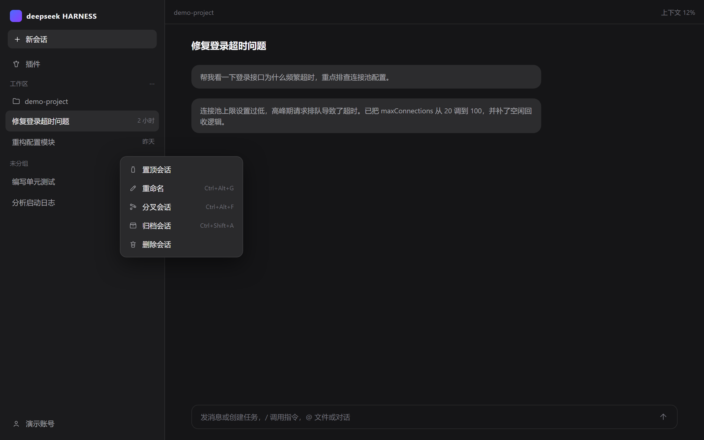
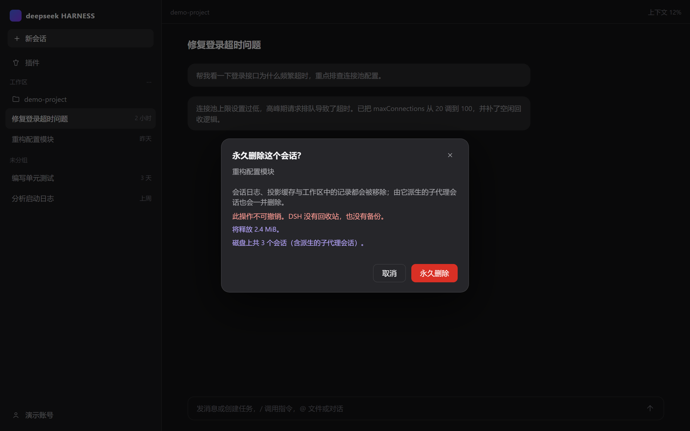
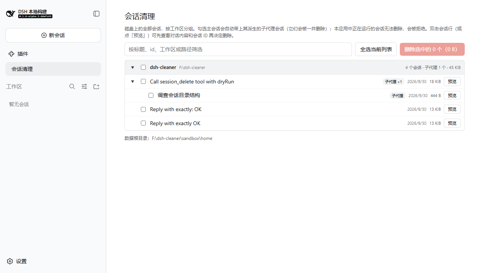
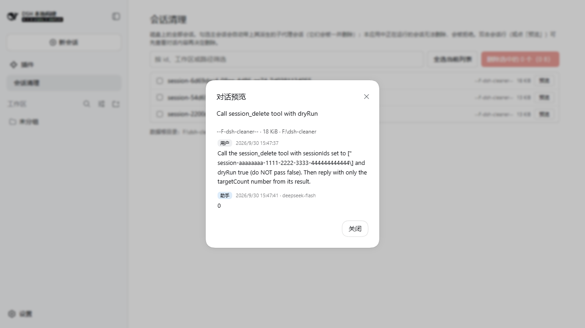

# dsh-plugin-session-cleaner

给 DeepSeek Harness 桌面版 / Web 版补上**删除会话**的能力。

DSH 本身没有任何删除会话的途径：`sessionPersistence` 只有 `create/open/stat/list`，`sessionController` 没有 delete，侧边栏会话菜单只有 pin / rename / fork / archive，连官方「删除工作区」的文案都写着「会话记录会保留」。本插件补上这个缺口，并把删除做彻底。

## 它删什么

删一个会话时，以下位置会被一并清除：

| 位置 | 内容 |
|---|---|
| `~/.dsh/sessions/<工作区slug>/<sessionId>/` | 会话日志 `session.vN.jsonl.zstd`（唯一真相） |
| `~/.dsh/storages/session_projcache/sessions/<sessionId>.json` | 投影缓存 |
| `~/.dsh/storages/workspace.json` | 该 id 在 `sessionIds`、`archivedSessionIds`、`pinnedSessionIds` 中的引用 |
| `~/.dsh/storages/*.db` | 派生搜索索引（存在且无法再对齐时整体移除，下次搜索自动重建） |

**它不碰**：`.credentials.yaml`、`settings.yaml`、`.anonymous-user-id`、`AGENTS.md`、`.env`、`skills/`、`profiles/`、`dsh-runtimes/`，以及工作区注册表里的工作区本身。

## 界面

以下为示意图（演示数据，非真实会话）：









## 三个入口

1. **侧边栏 · 会话「…」菜单 → 「删除会话」**（排在官方「归档」之后，order 500）。点击后弹确认框，显示会话标题、将要释放的空间、以及是否包含派生子代理会话。
2. **侧边栏 · 「会话清理」页**（与「插件」「自动化任务」同级的全局面板）：磁盘上的全部会话**按工作区分组**展示（组头为工作区短名 + 完整路径 + 会话数/子代理数/总大小，默认收缩，可展开/收起，组头带三态勾选）。行以**会话标题**展示（取自投影缓存，缺失时回退灰色显示 id），**子代理会话嵌套在父会话行下**（带「子代理」徽标，父行可展开；父会话已不在磁盘上的孤儿子代理平铺显示）；支持按标题、id、工作区或路径筛选，命中的组自动展开。勾选主会话会自动带上其派生的子代理会话（Host 删除时它们本就会一并删除，勾选集合与实际删除闭包保持一致，取消勾选同理向上传播）。**双击会话行或点行内「预览」按钮可先查看对话内容**：标题、**会话 ID 与随删的子代理会话 ID**、双方消息与模型名（Remote `read` 方法解码多帧 zstd 日志并过滤 DSH 注入的运行时上下文，只读、不改动任何数据）。预览弹窗默认宽 `min(92vw, 920px)`、高 `min(84vh, 680px)`，右下角手柄可拖拽调整（双击手柄恢复默认，Esc / 点遮罩关闭，所选尺寸在会话间保留）；官方 Modal 宽度固定 380px 且不收尺寸 props，因此预览走复用宿主设计变量的自制卡片，确认弹窗仍走官方 Modal。
3. **模型 Tool `session_delete`**：默认 `dryRun: true` 只列清单，必须显式传 `dryRun: false` 才真删。

## 安全设计

- **不可撤销**。DSH 没有回收站、没有软删除层、本插件不做备份。确认框会明确写这一点。
- **三重路径校验**：会话 id 必须匹配 DSH 的 id 语法；磁盘上的目录名必须与该 id 完全相等；规范化后的绝对路径必须落在 `sessions/` 或 `storages/` 之内。任一条不通过就整条跳过并记录原因，绝不猜、绝不越界。
- **不能删除当前打开的会话**：UI 禁用入口，Host 侧独立再拒一次（`guard` 参数），Tool 也拒绝把自己所在的会话作为目标。
- **运行中的会话先停止再删**：否则内存里的 Agent 会继续往刚删掉的日志追加写入，残留一个半截会话。若在超时内无法停止，**整个操作中止，一个文件都不删**。
- **递归删除子代理会话**：通过日志头部的 `parentSession` 字段展开全部后代，避免产生永远无法访问的孤儿数据。
- **注册表摘除走两条路**（见下节「删除如何立即反映到界面」）：宿主的 `workspaceRegistry` 服务在线时，摘除通过 `unarchiveSession` / `detachSession` 走**内存注册表**（它同时是 `workspace.json` 在删除期间的唯一写者），并在文件删除**之后**执行；服务不可用时回退为删除前原子改写 `workspace.json` 文件，保证重启后不会出现「看得见、点开报错」的空壳行。

## 删除如何立即反映到界面

DSH 侧边栏的会话行由两个数据源合成：行的**存在**来自客户端 `sessions` 服务的列表快照（只在连接建立时通过 `session/list` 拉取一次，而 Host 的 `session/list` 每次都实时扫盘），行的**分组/归档/置顶**来自 `workspaceController` 的 follow 流（内存注册表投影）。直接改磁盘文件两边都不会察觉——官方 README 明确把「外部变更延迟可见」列为已知限制。

因此删除的收尾是两步正规通道：

1. **Host 侧**（动态注入 `workspaceRegistry`，不在顶层 `inject` 里——缺服务的组合仍要能激活插件）：对每个已删 id 先 `ctx.emit('api-session/removed', id)`——宿主 session-controller 释放会话时用的同一个事件，客户端收到后在**本地**移除该行，无 RPC 往返；随后依次 `unarchiveSession`（幂等，顺带清置顶互斥）、`unpinSession`（如置顶）、对记账实体 `detachSession`。emit 必须先于 registry 调用：detach 推送的 follow 增量会把仍留在快照里的行赶到「未分组」，直到 refresh 落地——先 emit，行在增量到达前就已消失。每次 registry 调用都更新内存注册表、持久化并向 follow 流推送增量；调用失败只记入结果的 `warnings`——文件已删，残留记账在下次启动时被宿主剪除，报「删除失败」反而误导。若网关不转发插件 emit 的该事件，行为退化为短暂的「未分组」闪现，不会更糟。
2. **客户端**（动态注入 `sessions` 服务）：删除成功后先调一次 `ctx.sessions.refresh()` 重新拉取 `session/list`，**等它落定后**再对每个已确认删除的 id 调一次 `ctx.sessions.handleSessionRemoved(id)`（官方转发事件 `api-session/removed` 的同一个公开处理器）。顺序是硬约束：`refreshList()` 启动时会换新变更数组，pull 之前记录的移除（比如转发事件带来的）会在 pull 落地时被丢弃；而 Host 的 `session/list` 对**仍 attach 在内存里的会话**无条件返回（`SessionCorpus.listSessions` 的 live 优先合并，agent.cancel 只停 turn 不 detach，detach 能力只在会话创建方手里）——所以单靠 refresh，刚删的行会被合并回来的 baseline 复活进「未分组」，直到重启。refresh 之后调用 `handleSessionRemoved` 则行当场消失，且移除变更留在当前变更数组里被**下一次** refresh 重放，对仍 attach 的被删会话有一轮抗复活保护。已确认删除的 id 会在面板里登记为「已忘」清单，客户端还挂着一个**快照守卫**：订阅 `sessions` 快照变更，凡「已忘」的 id 重新出现（重连重建 baseline、任何时序竞争的复活），立即再移除一次——按实际存在判定，行掉出快照后守卫自然收敛。批量删除**部分失败**时，已确认删除的 id 同样走这条链，不会因为整体报失败而把删掉的行留在「未分组」。与此同时，客户端内的**删除信号**会通知已打开的清理面板重扫——面板的列表是挂载时的扫描快照，不重扫的话菜单删除的行会残留到面板重开为止；面板工具栏的「重新扫描」按钮兜住模型 Tool 删除这类任何客户端都看不到的变更。面板**自己发起**的删除则再快一拍：RPC 确认返回的瞬间，已确认删除的行就按结果里的 `deleted` 清单从快照里乐观移除（选中集与展开态同步收缩），随后的静默重扫不闪「正在扫描」、不清报告，只负责对账——大 profile 上一次全盘扫盘不再把「行消失」拖到几百毫秒之后。

先删文件、后摘注册表的顺序是有意的：行的存在由快照决定，若先摘注册表，仍留在快照里的行会先闪现到「未分组」。Tool（`session_delete`）路径没有客户端配合，侧边栏仍需等下一次连接或重启（面板可用「重新扫描」手动对齐）。

## 安装

**推荐：DSH「添加插件」对话框**。在 DSH 的「插件」页打开「添加插件」，输入包名 `dsh-plugin-session-cleaner`（npm 官方源与中国大陆镜像源均已上架），确认添加后**完全退出并重启 DSH**。

也可以手动声明 profile 依赖（效果等价）：

```jsonc
// ~/.dsh/profiles/<profile>/package.json
{
  "dependencies": { "dsh-plugin-session-cleaner": "^0.3.2" },
  "dsh": { "profile": { "bundles": [ /* ... */, "dsh-plugin-session-cleaner" ] } }
}
```

随后在 profile 目录执行 `pnpm install`。本地开发则把依赖指回工作树 `"file:<本仓库的克隆路径>\plugin"`，改完代码重新 `pnpm install`。

**安装后需要重启 DSH**：插件行在 Loader 配置中会先显示为 `absent`，只有重启才会激活（Host 侧与客户端 bundle 都是如此）。

原因不是配置未生效，而是 Node 对 ESM 模块按 URL 永久缓存：同一进程内即便重新启用该条目，`import()` 仍会拿到首次求值的那个模块实例。因此**修改已安装的插件代码后必须重启**，`set_plugin` 的禁用/启用不足以让改动生效。

## 开发

```sh
node build/client.mjs                          # 构建 lib/
node --test tests/cleaner.test.mjs \
           tests/plugin.test.mjs \
           tests/client.test.mjs               # 67 个测试
```

`build/client.mjs` 是一个零依赖的极简打包器：DSH 的客户端模块系统每个包只加载**一个自包含的 `client.js`**（entry 与 chunk 之间不能同步 require 另一个相对 `client*.js`），所以相对 require 被内联，React / react-dom 则保留为平台模块请求，由 shell 冻结的模块表应答。

`tests/verify-dry-run.mjs` 与 `tests/verify-delete.mjs` 用于对**真实**数据根做端到端验证，前者只预览、后者执行删除。

## 沙箱验证

首次安装曾导致桌面版启动崩溃，根因与修复都在隔离的沙箱数据根（`DSH_HOME` 指向独立目录 + `dsh sb --port 0 --no-open`，不碰真实 profile）里复现并验证过。沙箱目录含会话日志，**不随仓库分发**：

| 缺陷 | 症状 | 修复 |
|---|---|---|
| `package.json` 声明 `./typert` 导出但没有该文件 | typert-loader 导入失败 → **插件条目激活失败**（桌面版对此反应为崩溃重启并回滚 bundles） | 新增 `src/typert.host.js` + 构建生成 `lib/typert.host.js` |
| 契约用 `src-json` 编解码器 | typert-loader 拒绝：所有 codec（参数与结果）**必须是 strict** | strict + `typeSymbol` + 透传 `create()`（网关只调 `.parse()`，鸭子类型即可，无需 zod） |
| Host 侧调用 `remote.$mount()` | 向 Host 网关注册了无记录的描述符 | 移除——挂载是**客户端**的职责（与 whale-pet 一致） |
| 客户端 bundle 输出 `module.exports = ...` | 浏览器模块系统无法注册 | 改为官方格式 `window.__ModuleLoader__.load({id, factory})` |
| 曾把 `dsh.client.inject` 和插件对象的 `inject: ['slots']` 当作"不必要的组合依赖"删掉 | **菜单项与设置页永不出现**，界面与控制台都没有任何报错：客户端 factory 在 shell 发布 `slots` 服务之前执行 `ctx.slots.inject`，抛出的 TypeError 被空 `catch` 吞掉 | 两者都恢复（见下） |

修复后沙箱验证全过：冷启动**零警告**、bundle 以正确格式服务（HTTP 200，含菜单/设置页 slot、内联契约、中文文案）、**热重载存活**（运行中改 profile package.json 不再影响宿主）。

## 客户端插件必须对齐的五处约定

DSH 的客户端插件是惰性物化的，而且失败大多**无声**。下面三处都得自己声明清楚。

### 1. 服务依赖：等 `slots` 发布，`remote`/`typert` 必须显式声明

```js
// client.js — 插件对象上的服务依赖：apply 会一直等到这些服务就位
return { name: 'sessionCleanerClient', inject: ['slots', 'locale', 'remote', 'typert'], apply(ctx) { /* ... */ } }
```

缺 `slots` 时，factory 会在 shell 发布服务之前执行 `ctx.slots.inject`，抛出的 TypeError 被空 `catch` 吞掉——菜单项和设置页**永不出现**，界面与控制台都没有任何提示。`locale` 是下面第 3 条要用的服务。

**`remote` 与 `typert` 同理且更隐蔽**：Cordis 的 context 是代理，读取未在 `inject` 里声明的服务属性会直接抛 `cannot get property "remote" without inject`。曾经这两项漏声明，`acquire()` 里的 `.catch(() => undefined)` 把异常整个吞掉，于是确认弹窗永远停在「正在统计将要删除的内容…」、「永久删除」永远禁用——Host 服务、契约、slot 全都正常，坏在这一行读取上。`typert` 也是必需的：`$mount()` 内部通过**调用方**的 context 走 `callerCtx.typert.remotes.register(...)`，缺了它挂载必炸。

### 1b. namespace 服务要用组合键读取

`$mount()` 之后，每个 namespace 由 Gateway 以 `remoteServiceKey(namespace)`（即 `` `remote.${namespace}` ``）注册成一个 Cordis Service，实例挂在 context 的**同名属性**上。所以动态注入拿到 scope 后要读 `scope['remote.sessionCleaner']`——写成 `scope.remote.sessionCleaner` 是在 Remote 管理器对象上找子属性，永远是 `undefined`，且不抛任何错误。另外 `$mount()` 成功后**不得重试**：Typert Remote store 按包名登记，第二次注册直接抛 `already registered`；只有失败的挂载可以重试。

### 2. 客户端模块的激活顺序

```jsonc
// package.json — 列表里只能是真实存在且已启用的客户端包
"dsh": { "client": {
  "platform": "web",
  "immediately": true,
  "inject": ["@deepseek-ai/dsh-client-ui-workspace", "@deepseek-ai/dsh-client-ui-settings"]
}}
```

`dsh.client.inject` 只决定激活顺序（`immediately` 在浏览器侧目前并未被消费）。组合阶段会**拒绝"缺失提供方"**，因此写错包名会让整张启动图失败，比不写更糟——加包名之前先用 `tools/asar-read.mjs` 确认它出现在 `@deepseek-ai/dsh-web-app/cordis.patch.yml` 里，并且自带 `dsh.client.platform: web`。

### 3. slot 传进来的 props 不能猜，菜单行要用官方的 `MenuItemButton`

菜单行不要自己写 `<button>`：官方 pin/rename/fork/archive 行全部渲染自 `@deepseek-ai/dsh-client-ui-primitives` 的 `MenuItemButton`（隐式 baseline external——Module Loader lane 的 `require` 直接解析它，不要打包副本），自带宿主字体、行距、hover 与键盘走查；图标用同一包的 `Icon*OutlineRegular` 系列（如 `IconTrashOutlineRegular`，默认 16px 与其他行一致）。自己写的按钮字体、对齐、间距都与官方行不一致。

```js
// factory(require) 顶部；失败时回退普通按钮，行仍然可用
let MenuItemButton, IconTrashOutlineRegular
try {
  const primitives = require('@deepseek-ai/dsh-client-ui-primitives')
  ;({ MenuItemButton, IconTrashOutlineRegular } = primitives)
} catch { /* stand-alone stubs */ }

// 行内：icon 占图标槽，children 是标签
React.createElement(MenuItemButton, { icon: React.createElement(IconTrashOutlineRegular), onSelect }, t('menu.delete'))
```

`sidebar.workspaces.session.menu.item` 的条目只收到 `sessionId` 与 `displayTitle`，外加一个 **slot 级 hook**：

```js
const [, setMenuOpen] = props.useMenuOpenState()   // 返回 [open, setOpen] 元组
setMenuOpen(false)
```

把这个 hook 的返回值当函数调用（`closeMenu()`）会在点击时抛 TypeError，`setOpen(true)` 永远执行不到——**菜单项看得见，点了毫无反应**。

当前语言取自 locale 快照的 `active` 字段（不是 `id` / `locale`）：

```js
const snapshot = ctx.locale?.getLocale?.()        // { active, locales, revision }
const id = typeof snapshot.active === 'string' ? snapshot.active : snapshot.active?.id
```

### 4. 对话框不能住在菜单项里

菜单条目是**随菜单存亡**的：点击它会关闭菜单，而条目在同一次提交里就被卸载。把确认框渲染在条目内部（哪怕用 `createPortal` 挂到 `document.body`），它会在画出来之前被丢掉——**菜单项看得见，点了毫无反应**，控制台也不会有任何错误。

正确做法是拆成两半：条目只关闭菜单并**发出请求**，对话框交给常驻的 `shell.overlay` 条目渲染。官方包的重命名、停止并归档对话框都是这个结构（`@deepseek-ai/dsh-client-ui-workspace/README.zh.md`：「浮层也自己带……注册在 `shell.overlay` 的条目」）。

```js
// 菜单条目：只发请求，不持有对话框状态
onClick: () => { setMenuOpen(false); store.request(sessionId, displayTitle) }

// 常驻条目：frame-wide，菜单关了它还在
ctx.slots.inject('shell.overlay', () => ctx.slots.register({
  name: 'shell.overlay', id: 'session-cleaner.confirm', order: 90,
}, ConfirmDialog))
```

两个配套细节：`shell.overlay` 的容器通常关闭命中测试（`pointer-events: none`），对话框要显式声明 `pointerEvents: 'auto'`；条目空闲时渲染一个隐藏节点而不是 `null`，免得被当作"没有条目"。

### 改完必须重启

Host 把每个包的 `dsh.client` 元数据缓存在内存里**直到重启**；禁用/启用条目不足以让它重新读取，`lib/client.js` 的新产物也不会被重新组合。客户端同理：Web view 会缓存旧 bundle，重启后最好再硬刷新一次（`Ctrl+Shift+R`），否则客户端跑的仍是旧逻辑——症状是「Host 行为变了、界面没变」的混合版本。

权威写法见 DSH 内置 `cordis-plugin-development` skill 的 `templates/decoration/{package.json,client.js}`，以及 `@deepseek-ai/dsh-client-ui-workspace/README.zh.md` 的「Session 行 action」一节。桌面版里它们都在 `app.asar` 内，用 `tools/asar-read.mjs` 取出来。

## 结构

```
plugin/
├─ src/
│  ├─ cleaner.js      纯逻辑：扫描、级联展开、路径校验、注册表摘除、对话转录、计划与执行
│  ├─ index.js        Host 插件：服务（list / preview / read / delete）、Remote 绑定、Tool 注册、会话停止
│  ├─ contract.cjs    Remote 契约（CJS，两半共用，strict 编解码器）
│  ├─ typert.host.js  typert 严格反射（typert-loader 按 ./typert 约定加载）
│  └─ remote.js       Host 侧的契约入口
├─ client/            Web 客户端源码（菜单项 + 确认弹窗 + 全局面板页）
├─ build/client.mjs   构建（lib/ 转发 + 客户端单文件打包）
├─ lib/               构建产物
├─ locale/            中英文案
└─ tests/             单元与集成测试
```

Host 侧**不静态导入任何 `@deepseek-ai/*` 包**：profile 中的这些条目有一部分是无法解析的断链，静态依赖会让插件在加载时直接失败。所需能力全部通过 Cordis 上下文注入获得。
